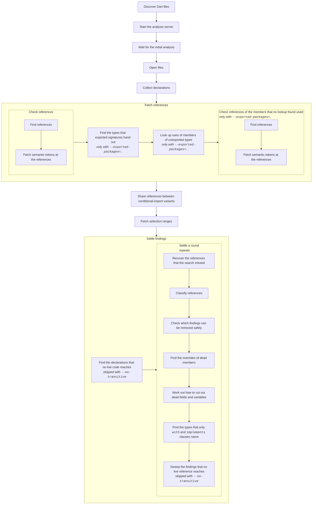

<!-- Written by test/finder/pipeline_test.dart; rewrite it with
     `UPDATE_GOLDENS=1 dart test test/finder/pipeline_test.dart`. -->

# How a scan runs

Each box is a step of a scan, and a box that holds other boxes runs them in
order. The diagram is drawn from scans of `example/`, so it shows the steps
that `lib/src/finder.dart` and `lib/src/settle/settler.dart` mark with
`stage(…)`. A note under a step names the options that it depends on.

