<!-- Written by tool/pipeline_graph; rewrite it with
     `dart run bin/pipeline_graph.dart` in tool/pipeline_graph. -->

# The calls of a scan

Each box is a call that `Ciach._run` in `lib/src/finder.dart` makes into
`workspace/`, `conventions/`, `project_config/`, `collect/`, `fetch/`, `settle/`, read from the source
without running it. A box that holds other boxes lists the calls that its
callee makes, up to 2 files deep, and a note under a call gives the
conditions around it.

```mermaid
flowchart TD
  s0["<code>discoverDartFilesSplit</code> <i>workspace/</i>"]
  s1["<code>unresolvedPackages</code> <i>workspace/</i>"]
  subgraph s2 ["<code>pathDependentsOutside</code> <i>workspace/</i><br/><i>if (options.includePublic &amp;&amp; options.analysisRootPath == null)</i>"]
    s2_0["<code>readPubspec</code> <i>project_config/</i>"]
    s2_1["<code>scanPackageTree</code> <i>workspace/</i>"]
    s2_0 --> s2_1
  end
  s3["<code>commonAncestor</code> <i>workspace/</i><br/><i>if (options.includePublic &amp;&amp; options.analysisRootPath == null)</i>"]
  subgraph s4 ["<code>analysisOptionsWithoutLints</code> <i>workspace/</i>"]
    s4_0["<code>PackageResolver.resolve</code> <i>workspace/</i><br/><i>in a loop</i>"]
    s4_1["<code>PackageResolver.resolve</code> <i>workspace/</i><br/><i>in a loop</i><br/><i>if (packages.resolve(include, from))</i><br/><i>in a loop</i>"]
    s4_2["<code>PackageResolver.resolve</code> <i>workspace/</i><br/><i>in a loop</i><br/><i>in a loop</i>"]
    s4_0 --> s4_1 --> s4_2
  end
  s5["<code>PublicApi.isImportable</code> <i>workspace/</i><br/><i>in a loop</i>"]
  s6["<code>ConditionalImports.contains</code> <i>conventions/</i><br/><i>in a loop</i>"]
  subgraph s7 ["<code>CandidateCollector.collect</code> <i>collect/</i><br/><i>if (opened.contains(path))</i>"]
    s7_0["<code>semanticTokensOrEmpty</code> <i>fetch/</i>"]
    s7_1["<code>ConditionalImports.contains</code> <i>conventions/</i>"]
    s7_2["<code>ConditionalImports.pairingNames</code> <i>conventions/</i><br/><i>if (_conditionalImports.contains(path))</i>"]
    s7_3["<code>FreezedUnions.noteIfAnnotated</code> <i>conventions/</i><br/><i>in a loop</i>"]
    s7_4["<code>exportsOf</code> <i>collect/</i><br/><i>in a loop</i>"]
    s7_5["<code>KeptDeclarations.byMarker</code> <i>collect/</i><br/><i>in a loop</i><br/><i>if (markers.keeping(start: start, nameLine: candidate.symbol.selectionRange.start.line))</i>"]
    s7_6["<code>translationsOf</code> <i>conventions/</i><br/><i>in a loop</i>"]
    s7_7["<code>isTranslationMessage</code> <i>conventions/</i><br/><i>in a loop</i>"]
    s7_8["<code>KeptDeclarations.isEntryPoint</code> <i>collect/</i><br/><i>in a loop</i>"]
    s7_9["<code>PublicApi.exposes</code> <i>workspace/</i><br/><i>in a loop</i>"]
    s7_10["<code>KeptDeclarations.withoutContainers</code> <i>collect/</i>"]
    s7_0 --> s7_1 --> s7_2 --> s7_3 --> s7_4 --> s7_5 --> s7_6 --> s7_7 --> s7_8 --> s7_9 --> s7_10
  end
  subgraph s8 ["<code>CandidateCollector.reportSkipped</code> <i>collect/</i>"]
    s8_0["<code>KeptDeclarations.report</code> <i>collect/</i>"]
  end
  s9["<code>ReferenceFetch.references</code> <i>fetch/</i>"]
  s10["<code>ReferenceFetch.semanticTokensFor</code> <i>fetch/</i>"]
  s11["<code>ReferenceFetch.references</code> <i>fetch/</i>"]
  s12["<code>ReferenceFetch.semanticTokensFor</code> <i>fetch/</i>"]
  subgraph s13 ["<code>ReachableTypes.find</code> <i>fetch/</i>"]
    s13_0["<code>PublicApi.isImportable</code> <i>workspace/</i><br/><i>in a loop</i><br/><i>in a loop</i>"]
    s13_1["<code>ReferenceFetch.fetchSelectionRanges</code> <i>fetch/</i>"]
    s13_2["<code>PublicApi.exposes</code> <i>workspace/</i>"]
    s13_0 --> s13_1 --> s13_2
  end
  subgraph s14 ["<code>probeMembers</code> <i>fetch/</i>"]
    s14_0["<code>ReachableTypes.filesFor</code> <i>fetch/</i>"]
    s14_1["<code>semanticTokensOrEmpty</code> <i>fetch/</i>"]
    s14_2["<code>ReachableTypes.filesFor</code> <i>fetch/</i>"]
    s14_0 --> s14_1 --> s14_2
  end
  s15["<code>ReferenceFetch.references</code> <i>fetch/</i>"]
  s16["<code>ReferenceFetch.semanticTokensFor</code> <i>fetch/</i>"]
  subgraph s17 ["<code>ConditionalImports.share</code> <i>conventions/</i>"]
    s17_0["<code>ReferenceClassifier.externalRefs</code> <i>settle/</i><br/><i>in a loop</i>"]
  end
  s18["<code>ReferenceFetch.selectionRanges</code> <i>fetch/</i>"]
  subgraph s19 ["<code>Settler.settle</code> <i>settle/</i>"]
    s19_0["<code>TransitiveSweep.allUnreached</code> <i>settle/</i><br/><i>if (options.transitive)</i>"]
    s19_1["<code>TransitiveSweep.liveRefs</code> <i>settle/</i><br/><i>in a loop</i>"]
    s19_2["<code>ReferenceRecovery.recover</code> <i>settle/</i><br/><i>in a loop</i>"]
    s19_3["<code>CrossLibraryReferences.merged</code> <i>fetch/</i><br/><i>in a loop</i>"]
    s19_4["<code>CrossLibraryReferences.whereNot</code> <i>fetch/</i><br/><i>in a loop</i>"]
    s19_5["<code>ReferenceClassifier.classify</code> <i>settle/</i><br/><i>in a loop</i>"]
    s19_6["<code>ReferenceRecovery.warnings</code> <i>settle/</i><br/><i>in a loop</i>"]
    s19_7["<code>FreezedUnions.deserializationOnlyArms</code> <i>conventions/</i><br/><i>in a loop</i>"]
    s19_8["<code>RemoveSafety.analyze</code> <i>settle/</i><br/><i>in a loop</i>"]
    s19_9["<code>Verdict.isSuppressed</code> <i>settle/</i><br/><i>in a loop</i>"]
    s19_10["<code>WholeTypes.reportOnly</code> <i>settle/</i><br/><i>in a loop</i>"]
    s19_11["<code>Verdict.canBeOverridden</code> <i>settle/</i><br/><i>in a loop</i>"]
    s19_12["<code>Verdict.finding</code> <i>settle/</i><br/><i>in a loop</i>"]
    s19_13["<code>OverrideRemovals.couple</code> <i>settle/</i><br/><i>in a loop</i>"]
    s19_14["<code>pairedStateRemovals</code> <i>conventions/</i><br/><i>in a loop</i><br/><i>in a loop</i><br/><i>if (candidate.symbol.kind == .class$)</i>"]
    s19_15["<code>Verdict.isRemovalBlocked</code> <i>settle/</i><br/><i>in a loop</i><br/><i>in a loop</i>"]
    s19_16["<code>Verdict.hintFor</code> <i>settle/</i><br/><i>in a loop</i><br/><i>in a loop</i>"]
    s19_17["<code>ReferenceClassifier.externalRefs</code> <i>settle/</i><br/><i>in a loop</i><br/><i>in a loop</i>"]
    s19_18["<code>DeadSpans.referrersAmong</code> <i>settle/</i><br/><i>in a loop</i><br/><i>in a loop</i>"]
    s19_19["<code>Verdict.finding</code> <i>settle/</i><br/><i>in a loop</i><br/><i>in a loop</i>"]
    s19_20["<code>Verdict.finding</code> <i>settle/</i><br/><i>in a loop</i><br/><i>in a loop</i>"]
    s19_21["<code>VariableCuts.withCuts</code> <i>settle/</i><br/><i>in a loop</i>"]
    s19_22["<code>removableIndices</code> <i>settle/</i><br/><i>in a loop</i>"]
    s19_23["<code>ClauseOnlyTypes.findings</code> <i>settle/</i><br/><i>in a loop</i>"]
    s19_24["<code>WholeTypes.report</code> <i>settle/</i><br/><i>in a loop</i>"]
    s19_25["<code>DeadSpans.enclosesInAnother</code> <i>settle/</i><br/><i>in a loop</i>"]
    s19_26["<code>TransitiveSweep.sweep</code> <i>settle/</i><br/><i>in a loop</i><br/><i>if (options.transitive)</i>"]
    s19_27["<code>DeadSpans.sameAs</code> <i>settle/</i><br/><i>in a loop</i>"]
    s19_28["<code>emptiedContainers</code> <i>settle/</i>"]
    s19_0 --> s19_1 --> s19_2 --> s19_3 --> s19_4 --> s19_5 --> s19_6 --> s19_7 --> s19_8 --> s19_9 --> s19_10 --> s19_11 --> s19_12 --> s19_13 --> s19_14 --> s19_15 --> s19_16 --> s19_17 --> s19_18 --> s19_19 --> s19_20 --> s19_21 --> s19_22 --> s19_23 --> s19_24 --> s19_25 --> s19_26 --> s19_27 --> s19_28
  end
  s0 --> s1 --> s2 --> s3 --> s4 --> s5 --> s6 --> s7 --> s8 --> s9 --> s10 --> s11 --> s12 --> s13 --> s14 --> s15 --> s16 --> s17 --> s18 --> s19
```

